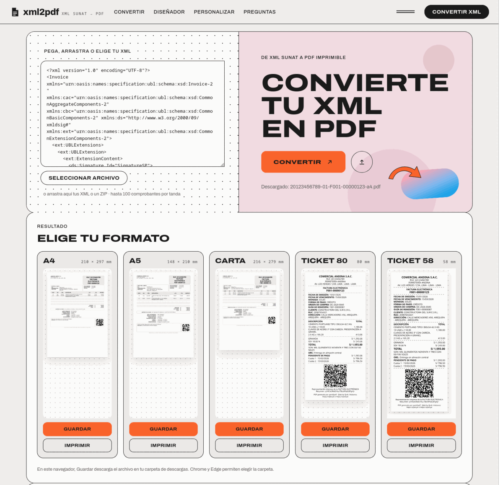
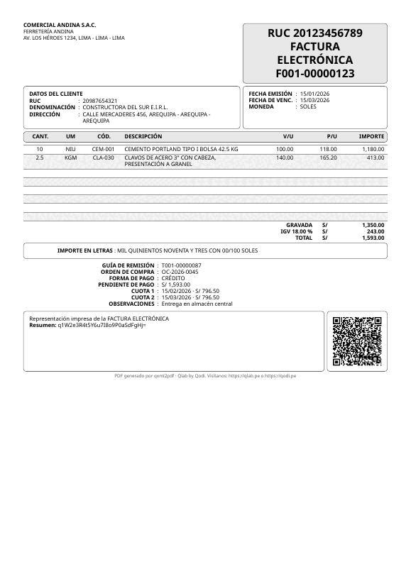
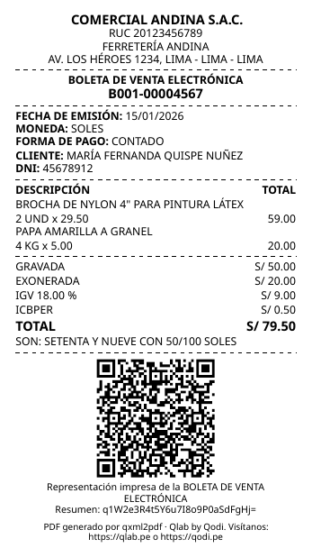
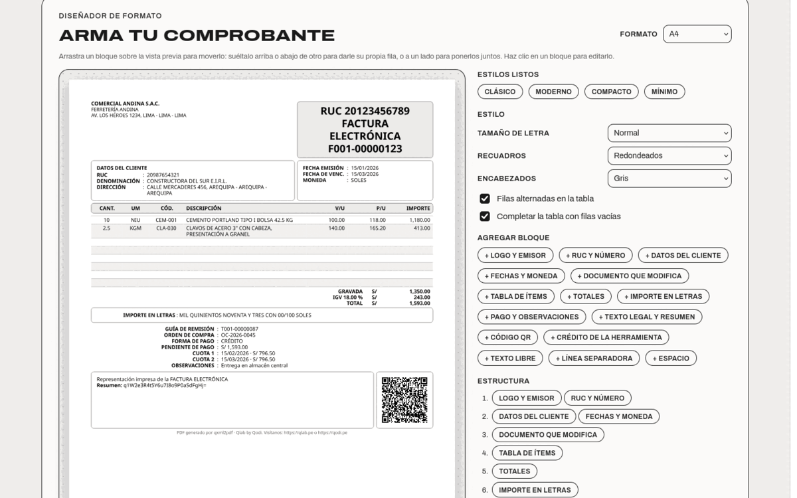
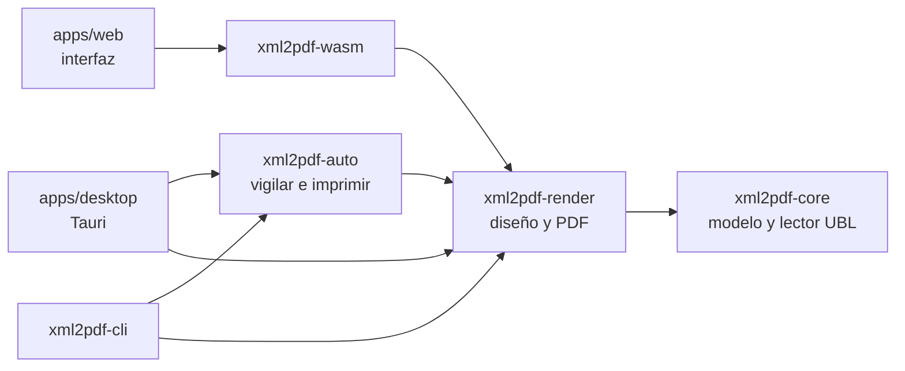

<h1 align="center">xml2pdf</h1>

<p align="center">
  Convierte comprobantes electrónicos de SUNAT (XML UBL 2.1) en PDF listos para imprimir.<br>
  Desde el navegador, la terminal o una aplicación de escritorio que imprime sola.
</p>

<p align="center">
  <a href="https://github.com/cbranty/xml2pdf/actions/workflows/ci.yml"></a>
  <a href="LICENSE"></a>
  
</p>

<p align="center">
  
</p>

> [!NOTE]
> El PDF es una representación impresa. El comprobante con validez tributaria sigue siendo el XML.

## Por qué existe

Quien factura desde el portal de SUNAT recibe un XML, no un documento que pueda entregar o imprimir con su propio formato. xml2pdf lee ese XML y genera el PDF en tu equipo: nada se envía a un servidor.

| | |
|---|---|
| **Privado** | La conversión ocurre en tu navegador o en tu computadora. |
| **Cinco formatos** | A4, A5, Carta, ticket de 80 mm y ticket de 58 mm. |
| **Editable** | Diseñador por bloques con arrastrar y soltar, logo, texto al pie y plantillas propias. |
| **Por lotes** | Varios XML o un ZIP a la vez, con descarga de todos los PDF en un ZIP. |
| **Impresión automática** | Vigila una carpeta y manda a la impresora cada comprobante nuevo. |
| **Libre** | Licencia MIT, escrito en Rust. |

## Inicio rápido

Todavía no hay versiones publicadas, así que por ahora se compila desde el código. Necesitas [Rust](https://rustup.rs) 1.92 o superior.

```bash
git clone https://github.com/cbranty/xml2pdf.git
cd xml2pdf
cargo install --locked --path crates/xml2pdf-cli   # instala el comando `xml2pdf`

xml2pdf convert fixtures/factura.xml               # crea factura.pdf junto al XML
xml2pdf convert descargas/ -o pdf/ -f ticket80     # una carpeta completa, en ticket
```

La web y el escritorio se compilan con los pasos de [Compilar desde el código](#compilar-desde-el-código).

## Tres formas de usarlo

| Pieza | Para qué sirve | Código |
|-------|----------------|--------|
| **Web** | Pegar, arrastrar o elegir un XML y ver el PDF en todos los formatos | [`apps/web`](apps/web) |
| **CLI** `xml2pdf` | Convertir archivos o carpetas, vigilar una carpeta e imprimir | [`crates/xml2pdf-cli`](crates/xml2pdf-cli) |
| **Escritorio** | La misma interfaz de la web, más impresión automática | [`apps/desktop`](apps/desktop) |

### Web

Pega el contenido del XML, arrástralo o elige el archivo y presiona **Convertir**. Verás la vista previa en los cinco formatos, cada una con **Guardar** e **Imprimir**. En Chrome y Edge, Guardar deja elegir la carpeta; en otros navegadores descarga el archivo.

Para convertir por lotes, elige o arrastra varios XML (o un ZIP) y usa **Guardar todos** para descargar un ZIP con los PDF. Cada tanda admite hasta 100 comprobantes y 50 MB; lo que exceda se omite con un aviso.

### Línea de comandos

| Comando | Qué hace |
|---------|----------|
| `xml2pdf convert <entradas>` | Convierte archivos XML o ZIP, o todos los de una carpeta |
| `xml2pdf watch <carpeta>` | Convierte, y si quieres imprime, cada XML o ZIP nuevo |
| `xml2pdf printers` | Lista las impresoras disponibles |
| `xml2pdf template` | Muestra la plantilla Typst integrada, para partir de ella |
| `xml2pdf data <xml>` | Muestra en JSON los datos que recibe una plantilla |

`xml2pdf <comando> --help` describe todas las opciones.

### Escritorio

Muestra la misma interfaz que la web y añade la sección **Impresión automática**: eliges la carpeta a vigilar, la impresora y las copias. Guardar abre el diálogo del sistema e Imprimir envía el PDF directo a la impresora.

## Comprobantes admitidos

| Código | Comprobante |
|--------|-------------|
| 01 | Factura |
| 03 | Boleta de venta |
| 07 | Nota de crédito |
| 08 | Nota de débito |

La entrada puede ser un XML (UTF-8 o ISO-8859-1) o un ZIP con varios. Los archivos de respuesta de SUNAT (`R-…xml`) se omiten. Otros tipos, como guías de remisión, retenciones y percepciones, todavía no están admitidos.

## Formatos y personalización

<p align="center">
  
  &nbsp;&nbsp;
  
</p>

| Opción | Valores | CLI |
|--------|---------|-----|
| Tamaño de papel | `a4`, `a5`, `letter` (Carta), `ticket80`, `ticket58` | `--format` |
| Diseño por bloques | hecho en el diseñador | `--config` |
| Logo | PNG, JPEG, GIF, WebP o SVG | `--logo` |
| Texto al pie | texto libre | `--footer` |
| Código QR | visible u oculto | `--no-qr` |
| Plantilla propia | archivo Typst | `--template` |

Las mismas opciones se pueden guardar en un archivo JSON y usar con `--config`; las opciones de la línea de comandos tienen prioridad.

```json
{
  "format": "a4",
  "issuer_lines": ["Tel. 01 555 0100", "ventas@ejemplo.pe"],
  "footer": "Gracias por su preferencia",
  "show_qr": true,
  "logo": "logo.png"
}
```

Todos los PDF terminan con una línea de crédito de la herramienta, con enlaces a qlab.pe y qodi.pe.

### Diseñador de formato

<p align="center">
  
</p>

En la web y en el escritorio, cada parte del comprobante es un bloque. Arrástralo sobre la vista previa para moverlo y haz clic en él para editarlo.

| Qué puedes cambiar | Cómo |
|--------------------|------|
| Estilo completo | Estilos listos: Clásico, Moderno, Compacto, Mínimo |
| Letra, recuadros, encabezados, filas de la tabla | Panel **Estilo** |
| Ancho, recuadro y alineación de un bloque | Clic en el bloque |
| Columnas de la tabla de ítems | Clic en la tabla |
| Texto propio, líneas y espacios | **Agregar bloque** |

**Exportar** guarda el diseño en un archivo JSON que el CLI acepta tal cual:

```bash
xml2pdf convert factura.xml --config diseno-xml2pdf.json
```

Si necesitas control total del dibujo, escribe tu propia plantilla Typst. El formato del archivo de diseño y los datos disponibles para una plantilla están en [docs/templates.md](docs/templates.md).

## Impresión automática

```bash
xml2pdf printers                                   # impresoras disponibles
xml2pdf watch ~/Descargas --print --printer Caja   # convierte e imprime cada XML nuevo
```

Los PDF se guardan en la subcarpeta `pdf` de la carpeta vigilada, salvo que elijas otra.

| Sistema | Cómo imprime | Requisito |
|---------|--------------|-----------|
| Linux y macOS | `lp` (CUPS) | CUPS instalado y una impresora configurada |
| Windows | SumatraPDF en modo silencioso | [SumatraPDF](https://www.sumatrapdfreader.org) instalado; sin él se usa la aplicación PDF predeterminada, que puede mostrar su ventana |

## Compilar desde el código

| Objetivo | Comando | Requisitos adicionales |
|----------|---------|------------------------|
| Pruebas | `cargo test` | — |
| Web | `./scripts/build-web.sh` (genera `dist/web`) | target `wasm32-unknown-unknown` y `wasm-bindgen-cli` de la misma versión que en `Cargo.lock` |
| Prueba de la interfaz | `python3 scripts/ui-check.py` (tras compilar la web) | Firefox |
| Escritorio | `./scripts/build-desktop-ui.sh` y luego `cargo run -p xml2pdf-desktop` | [Dependencias de Tauri 2](https://tauri.app/start/prerequisites/) |
| Instalador de escritorio | `cd apps/desktop && npm install && npm run build` | Las mismas de Tauri 2, más Node.js |

La guía completa para preparar el entorno está en [CONTRIBUTING.md](CONTRIBUTING.md).

## Desplegar la web

La web es un sitio estático servido por Caddy dentro de una imagen Docker.

```bash
docker compose up --build      # http://localhost:8080
```

Para publicarla en [Dokploy](https://dokploy.com):

1. Crea una aplicación con este repositorio y tipo de build **Dockerfile** (ruta `./Dockerfile`).
2. Añade un dominio apuntando al puerto **80** del contenedor.
3. Define el argumento de build `SITE_URL` con la dirección pública, sin barra final. Con él se publican el enlace canónico, la imagen para redes y el `sitemap.xml`; sin él, esas partes se omiten.
4. Para desplegar desde CI, define en GitHub los secretos `DOKPLOY_URL`, `DOKPLOY_API_KEY` y `DOKPLOY_APPLICATION_ID`. El workflow `CI` despliega cada push a `main` después de pasar las pruebas; sin esos secretos, el paso se omite.

> [!IMPORTANT]
> Si despliegas desde CI, desactiva **Auto Deploy** en Dokploy. De lo contrario cada push se despliega dos veces, una de ellas antes de que terminen las pruebas.

La imagen compila el motor WebAssembly en el servidor: el primer build tarda varios minutos y consume bastante memoria.

La política del sitio solo permite incrustarlo en un marco desde `qlab.pe`; para otro dominio, cambia `frame-ancestors` en [`deploy/Caddyfile`](deploy/Caddyfile).

## Arquitectura

Un núcleo en Rust que no hace entrada ni salida, y tres aplicaciones delgadas encima. Las dependencias apuntan siempre hacia el núcleo.



| Carpeta | Contenido |
|---------|-----------|
| [`crates/xml2pdf-core`](crates/xml2pdf-core) | Modelo del comprobante y lector UBL 2.1 |
| [`crates/xml2pdf-render`](crates/xml2pdf-render) | Diseños por bloques, plantilla Typst y generación del PDF |
| [`crates/xml2pdf-auto`](crates/xml2pdf-auto) | Vigilancia de carpetas e impresión |
| [`crates/xml2pdf-cli`](crates/xml2pdf-cli) | Línea de comandos |
| [`crates/xml2pdf-wasm`](crates/xml2pdf-wasm) | Enlaces WebAssembly para la web |
| [`apps/web`](apps/web) | Interfaz, compartida por la web y el escritorio |
| [`apps/desktop`](apps/desktop) | Aplicación de escritorio (Tauri 2) |
| [`fixtures`](fixtures) | Comprobantes de ejemplo usados en las pruebas |

El detalle, con las reglas para agregar un tipo de comprobante, un formato de papel o un bloque, está en [docs/architecture.md](docs/architecture.md).

## Estado del proyecto

Versión 0.1.0, en desarrollo activo. Lo que conviene saber antes de usarlo:

| Área | Estado |
|------|--------|
| Conversión, diseñador y CLI en Linux | Probados con la batería automática |
| Compilación en Windows y macOS | Preparada en el workflow de versiones, aún sin ejecutar |
| Impresión en Windows | Implementada, aún sin probar en un equipo real |
| Versiones publicadas | Ninguna todavía; los instaladores y binarios se generarán al subir una etiqueta `vX.Y.Z` |

Los cambios de cada versión se anotan en [CHANGELOG.md](CHANGELOG.md).

## Contribuir

Los reportes de errores, los XML que no se convierten bien y las mejoras son bienvenidos. Lee [CONTRIBUTING.md](CONTRIBUTING.md) para preparar el entorno y conocer las reglas del proyecto.

> [!WARNING]
> Un XML real contiene datos de tu empresa y de tus clientes. Antes de adjuntarlo en un reporte, reemplaza RUC, nombres, direcciones y montos.

Para reportar una vulnerabilidad, sigue [SECURITY.md](SECURITY.md) en lugar de abrir un reporte público.

## Licencia

[MIT](LICENSE). Hecho por [Qlab](https://qlab.pe) by [Qodi](https://qodi.pe).

xml2pdf no está afiliado a SUNAT. La generación del PDF usa [Typst](https://typst.app) y la fuente [Noto Sans](https://fonts.google.com/noto/specimen/Noto+Sans).
