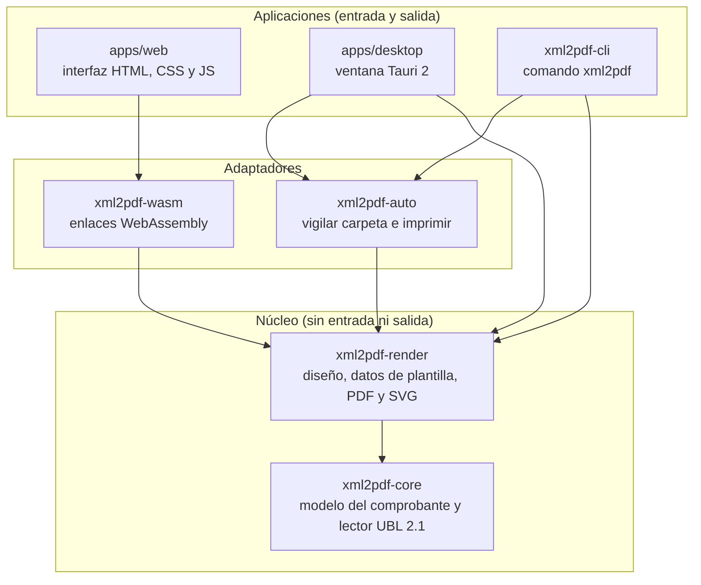
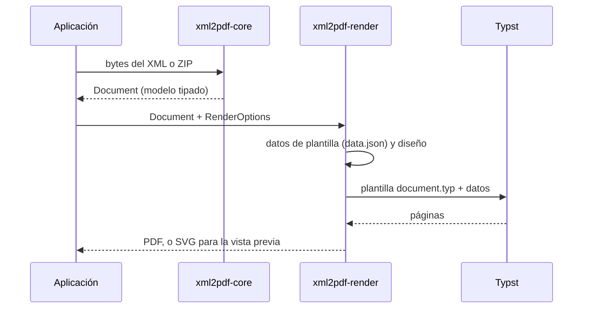

# Arquitectura

xml2pdf es un núcleo en Rust que no hace entrada ni salida, con tres aplicaciones delgadas encima: la línea de comandos, la web y el escritorio. Toda la lógica vive una sola vez en el núcleo; las aplicaciones solo la conectan con archivos, el navegador o la impresora.

## Mapa

La regla que sostiene todo: **las dependencias apuntan hacia el núcleo, nunca al revés.** `xml2pdf-core` no conoce a nadie; `xml2pdf-render` solo conoce a `core`; las aplicaciones conocen a ambos.

## Qué hace cada pieza

| Pieza | Responsabilidad | No debe |
|-------|-----------------|---------|
| `xml2pdf-core` | Leer el XML UBL 2.1 a un modelo tipado (`Document`), catálogos SUNAT, importe en letras, leer y escribir ZIP en memoria | Tocar disco, red o reloj; saber cómo se dibuja un PDF |
| `xml2pdf-render` | Formatos de papel, ajustes (`Settings`), diseños por bloques (`Design`), datos para la plantilla y generación de PDF y SVG con Typst | Leer XML directamente; saber de impresoras o ventanas |
| `xml2pdf-auto` | Vigilar una carpeta, convertir cada archivo nuevo e imprimirlo a través del puerto `Printer` | Tener interfaz de usuario |
| `xml2pdf-cli` | Traducir argumentos a llamadas del núcleo y mostrar resultados | Contener reglas de negocio |
| `xml2pdf-wasm` | Exponer el núcleo a JavaScript | Contener reglas de negocio |
| `apps/web` | Interfaz compartida por la web y el escritorio | Calcular nada del comprobante: todo lo pide al motor |
| `apps/desktop` | Ventana, diálogos del sistema, ajustes guardados e impresión directa | Duplicar la interfaz de la web |

## Recorrido de una conversión

Hay una sola plantilla integrada, `crates/xml2pdf-render/templates/document.typ`. No dibuja un comprobante fijo: recorre las filas y bloques del diseño y dibuja cada uno. Por eso un formato o estilo nuevo no necesita otra plantilla.

## Dos puertos

Un puerto es una interfaz que el núcleo define y cada aplicación implementa a su manera. Hay dos:

| Puerto | Dónde se define | Implementaciones |
|--------|-----------------|------------------|
| `Printer` (Rust) | `crates/xml2pdf-auto/src/printer.rs` | `SystemPrinter`: CUPS en Linux y macOS, SumatraPDF o la aplicación predeterminada en Windows. Las pruebas usan una impresora falsa. |
| Plataforma (JavaScript) | `apps/web/platform.js` | La web guarda con el navegador; el escritorio reemplaza el módulo por `apps/desktop/ui/platform.js`, que llama a los comandos de Tauri. |

Gracias al segundo puerto, la web y el escritorio comparten los mismos `index.html`, `app.js` y `designer.js`. `scripts/build-desktop-ui.sh` copia la interfaz y solo cambia ese módulo.

## Cómo agregar algo

| Quiero agregar | Dónde se toca |
|----------------|---------------|
| Un tipo de comprobante | `model.rs` (`DocumentKind`), `parser.rs` (elemento raíz y líneas) y `catalog.rs` en `xml2pdf-core`; un XML de ejemplo en `fixtures`; una prueba en `crates/xml2pdf-core/tests/parse.rs` |
| Un bloque del diseño | `design.rs` (`BlockKind` y su etiqueta), `view.rs` si necesita datos nuevos y `document.typ` para dibujarlo. El diseñador lo muestra solo, porque lee el catálogo desde el motor |
| Un estilo listo | `design.rs` (`Preset`). El diseñador lo muestra solo |
| Un formato de papel | `PaperFormat` en `xml2pdf-render`, `media_for` en `xml2pdf-auto` y las listas de formatos de la interfaz (`apps/web` y `apps/desktop/ui`) |
| Una forma de imprimir | Una implementación de `Printer` en `xml2pdf-auto` |
| Un comando del CLI | `crates/xml2pdf-cli/src/main.rs`, con su prueba en `crates/xml2pdf-cli/tests/cli.rs` y su línea en el README |

## Decisiones y por qué

| Decisión | Motivo |
|----------|--------|
| El núcleo no hace entrada ni salida | El mismo código corre en nativo y en WebAssembly, y se prueba sin disco ni red |
| Typst como biblioteca, no como programa externo | Un solo binario, sin dependencias que instalar, y funciona en el navegador |
| Diseños como datos (filas de bloques), no una plantilla por formato | El usuario los edita arrastrando; se guardan en JSON y sirven igual en la web, el escritorio y el CLI |
| Interfaz sin framework ni empaquetador | La web es estática y pequeña; no hay cadena de compilación de JavaScript que mantener |
| Importes con `rust_decimal`, con magnitud acotada | Los montos no admiten error de redondeo, y un XML malicioso no debe provocar un desbordamiento |
| Límites al leer ZIP (tamaño por XML y cantidad) | Un archivo comprimido no debe poder agotar la memoria |

## Pruebas

| Nivel | Dónde | Qué cubre |
|-------|-------|-----------|
| Unidad e integración | `crates/*/tests` | Lectura de XML, diseños, PDF generado, CLI, vigilancia e impresión con una impresora falsa |
| Motor en WebAssembly | `scripts/smoke-web.mjs` | Que el paquete de la web convierte los ejemplos |
| Interfaz en navegador | `scripts/ui-check.py` | Pegar, error, lotes, límites, diseñador y escritorio, en Firefox sin ventana |

Las pruebas entran por la interfaz pública de cada pieza y usan los comprobantes de `fixtures`.
